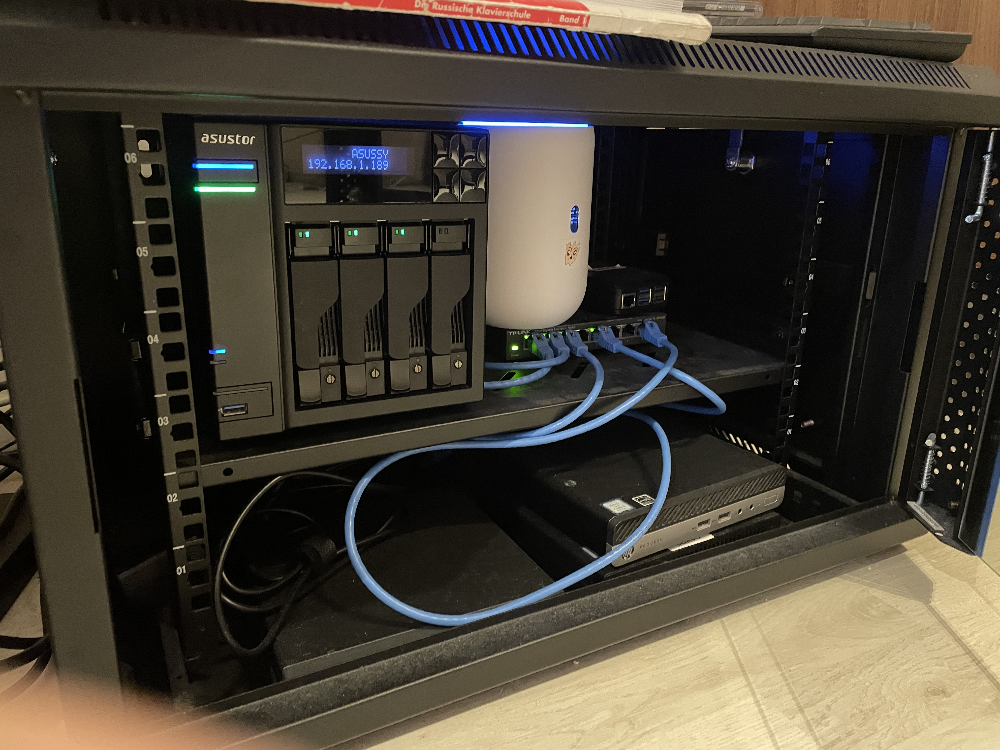
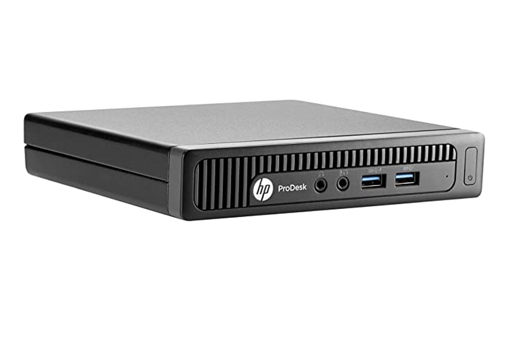
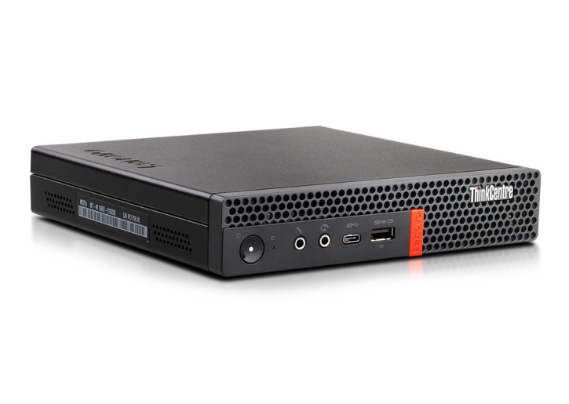
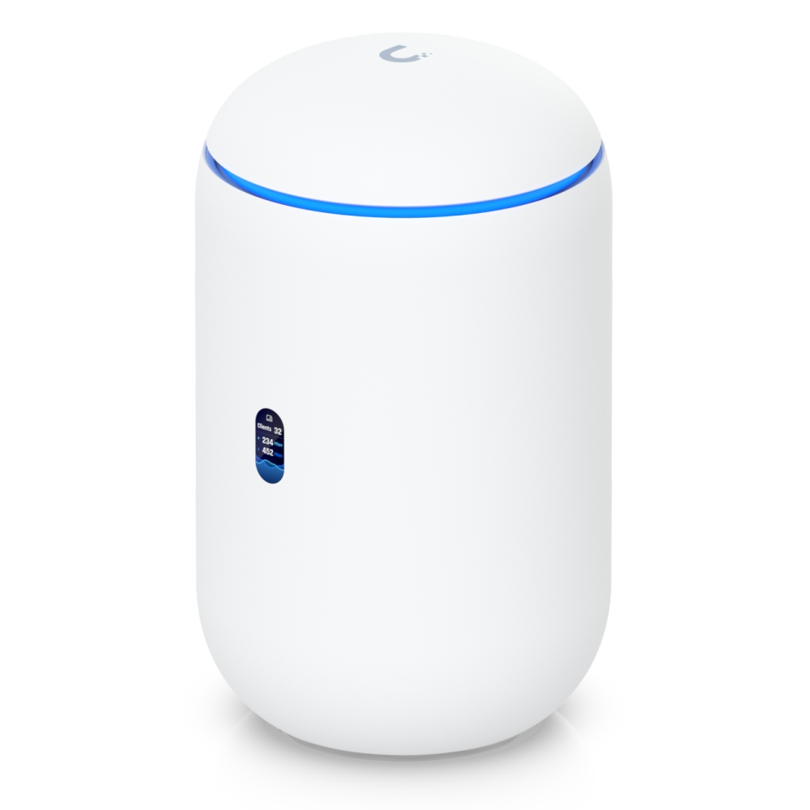
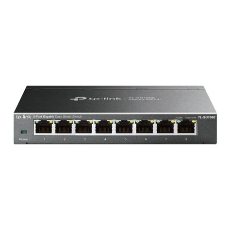
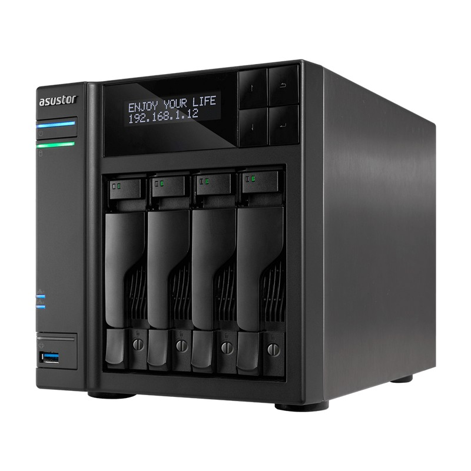
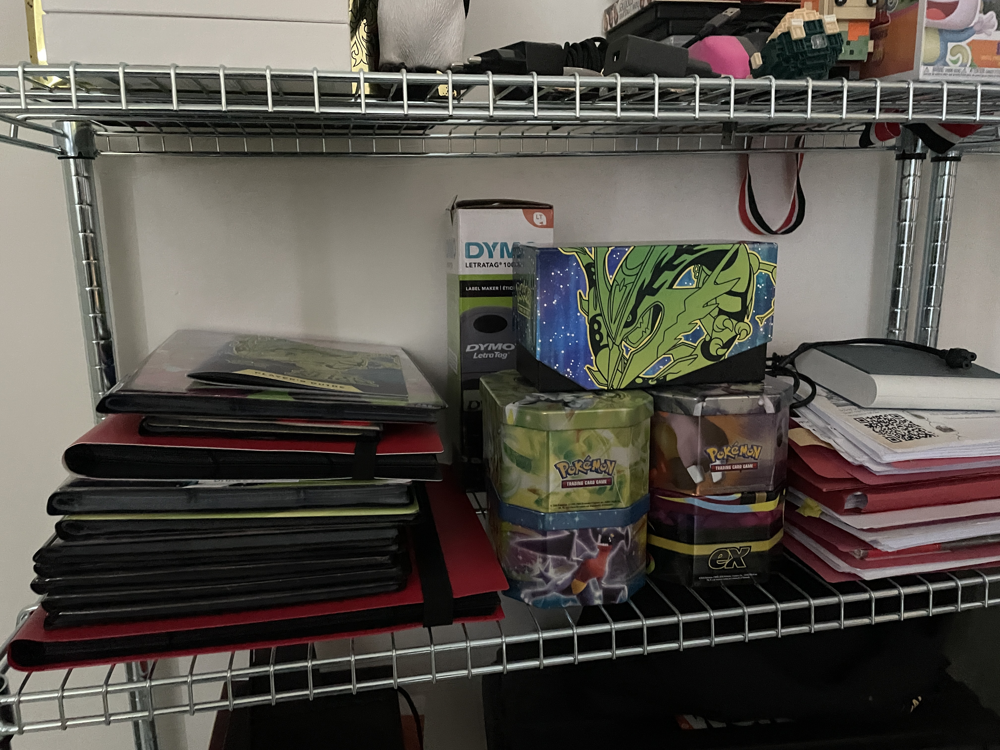

# Homelabbing

---

## What is homelabbing?

### Definition from Wiktionary:

> (computing) A server set up in one's home for the purpose of testing various configurations of hardware, operating systems, etc.

---

## What is homelabbing?

### Definition from me:

> (nederlands) Een prutsomgeving waar niets aan vasthangt, waar je te veel tijd, geld en moeite insteekt. Wel tof!

---

## Why should it matter to me?

Productie-systeem, maar niet helemaal:

- Geen SLA's
- Geen tijdsrestricties
- On-premise
- Geen boze klanten*

---

## Experimentatie - virtualisatie (optioneel)

- Virtualisatie: efficiënt gebruiken van hardware
- VirtualBox: good in a pinch/tijdelijk testen, maar geen permanente services
- Type 2 hypervisor versus Native OF Type 1 Hypervisor!

---

## Experimentatie - goede leersschool

- Persoonlijke sandbox -> if it breaks, it breaks.
- Geen verwachtingen, regels of verplichtingen
- Technische skills en leren documenteren...

---

## Digital sovereignty

> Fancy mandatory buzzword, MAAR!

- Onafhankelijk van Cloud (en Big Tech)
- Data privacy!
- Open Source!
- Transparantie!
- Geen licentiekosten of abonnementen!

---

## Start small!

- Oude laptop, oude PC
- Hardware moet niet extreem sterk zijn
- Zeker nu: RAMpocalypse

---

## Hardware

- Zoek tweedehands!
- Oude laptops/toestellen repurposen
- Navraag bij vrienden/familie
- Mensen smijten vaak dingen weg die voor ons nog bruikbaar zijn

---

## Linux, Linux, Linux

- Linux is your best friend!
- 1 toestel met Linux en Docker (Compose) geïnstalleerd -> meer heb je niet nodig!
- Kijk (eerst) naar een basisdistro (Ubuntu Server, AlmaLinux, ...)
- Headless/CLI: veel minder resources nodig dan GUI 

---

## Docker

- Virtualisatie op applicatie-niveau
- Niet de focus van vandaag, maar fantastische tool
- Meer info? Online en slides van [IT-Lab Workshop](https://hogent-it-lab.github.io/docker-workshop/slides)

---

## Any% Docker speedrun

- Demo: hoe snel docker installeren op Linux-machine?
- OS: Ubuntu server (CLI-only)

## Fancy stuff

- Type 1 Hypervisor* (**Proxmox**)
- Custom domain name with HTTPS (**Caddy** of een andere reverse proxy)
- Storage for network and clients (**NAS**)

---

## Small homelab tour

---

## Small homelab tour - toestellen

- Proxmodes nodes (2 actief, 2 WIP)
- UniFi router
- TP-Link switch (unmanaged)
- Raspberry Pi 5 (flex/experimenteel)
- Asustor NAS

---

## Devices - Proxmox nodes

- HP Prodesk - 8 GB RAM scavenged uitgefaseerd bij klant na PC-upgrade
- Lenovo ThinkCentre - 16 GB RAM scavenged 2ehands.be

---

## Devices - HP Prodesk

---

## Devices - Lenovo ThinkCenter

---

## Devices - UniFi router

---

## Devices - Unmanaged switch

---

## Devices - NAS

---

## Dashboard software tour (Homarr)

- Nextcloud
- Jellyfin
- Immich
- Pihole
- Netbox

---

## Secure remote access (VPN)

- Tailscale
- Toegang tot hele netwerk (subnet router functionaliteit)
- 1 Tailscale node in netwerk

---

## Custom apps

- Supereenvoudig om zelf iets te schrijven
- Dockerize and deploy
- Reverse proxy met Cloudflare DNS: certificaten en HTTPS!

---

## Weekmenu

- Te veel ADHD
- Te veel keuzestress
- Eenvoudige manier om weekmenu te genereren en aan te passen

---

## Stirling PDF

- Adobe Acrobat paywal? Grrrr
- Stirling PDF: open source tool
- Self-hosted en gratis, veel features!

---

## Nerd? No problem!

---

## Pokedex

- Geen idee wat ik al heb
- Geen idee hoe welke nummers ik ontbreek
- Papier is saai en kan ik vergeten